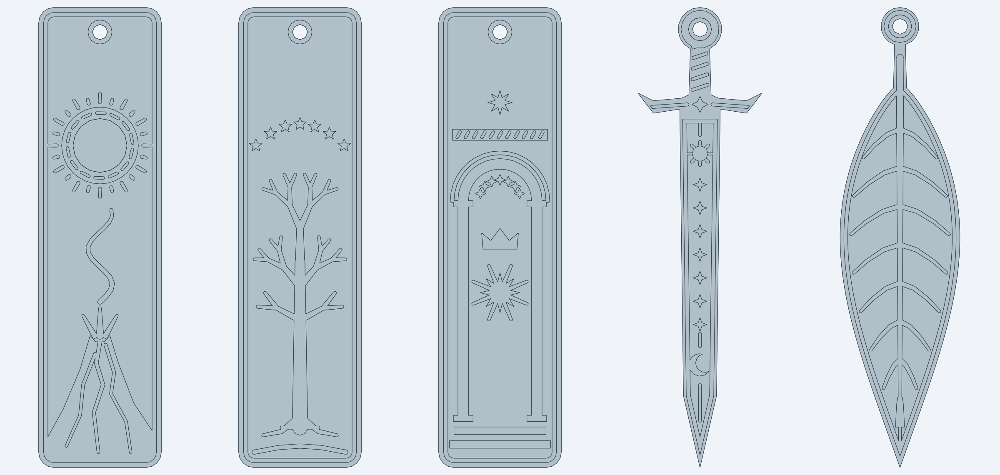

# Lord of the Rings bookmarks

Five 3D-printable bookmarks themed on *The Lord of the Rings*. They show no people or animals,
only objects, places, plants and emblems. They were modelled with the
[text-to-cad](https://github.com/earthtojake/text-to-cad) CAD skill (cadgen 0.7.24, build123d / Open CASCADE).



| File | Design | Size (mm) |
|---|---|---|
| `one_ring` | The One Ring, its inscription band cut into the metal, glowing above Mount Doom. Smoke rises from the crater and lava runs down the slopes. | 40 × 150 × 2.2 |
| `white_tree` | The White Tree of Gondor with roots and ground, beneath the seven stars | 40 × 150 × 2.2 |
| `doors_of_durin` | The Doors of Durin: pillars, a double arch, the Star of Fëanor, the crown and seven stars, a rune lintel and a star above | 40 × 150 × 2.2 |
| `anduril` | Sword-shaped: Andúril with a sun, seven stars and a crescent moon along the blade, a wrapped grip and a ring pommel | 40 × 148 × 2.2 |
| `lorien_leaf` | Leaf-shaped: a Leaf of Lórien with raised midrib and curling veins, hung from its stem loop | 38 × 146 × 2.2 |

Each has a 5 mm hole for a tassel or ribbon.

## Printing

- **Files:** `STL/` or `3MF/` (millimetres). `STEP/` holds the exact CAD solids for editing.
- **Orientation:** flat, as exported, with no supports.
- **Layers:** the base is 1.4 mm (7 × 0.2 mm) and the raised design adds 0.8 mm (4 × 0.2 mm).
  For two colours, add a **filament change at Z = 1.4 mm** (e.g. black base with gold, white or silver design).
- **Detail:** raised lines are at least 0.9 mm wide, so print with a 0.4 mm nozzle. Use 0.2 mm layers or finer.
- Every mesh has been checked as closed (watertight), consistently oriented, and a single body.

## Rebuilding

The models live in `src/`, and the shared bookmark helpers are in `src/lib/bookmark.py`. With [uv](https://docs.astral.sh/uv/) installed:

```bash
CADPY="uvx --no-config --managed-python --python 3.13 --from cadgen==0.7.24 python"
$CADPY src/one_ring.py        # writes STEP/one_ring.step (same for the other four)
$CADPY export_meshes.py       # writes STL/ and 3MF/ from the STEP files and checks each mesh is closed
```

The meshes are written with Open CASCADE's mesher instead of cadgen's own STL export. In cadgen 0.7.24, its
exporter left a few missing triangles on these flat faces with many holes, even though the CAD solids are valid.
