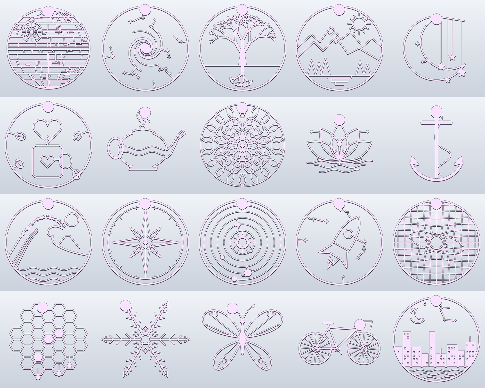

# Wall art cutouts: 20 single-colour line-art designs



These are line art cut out of one 4 mm thick piece, with no backing plate, in the style of the battle-station example.
Any FDM printer can print them in one colour with no supports.
Generated by [`tools/wall_art/cutouts.py`](../../tools/wall_art/cutouts.py) and built with SolidCraft.

Designs: battle-station, galaxy, tree-of-life, mountains, moon-stars, coffee-love, teapot, mandala, lotus, anchor,
wave, compass, solar-system, rocket, spacetime, honeycomb, snowflake, butterfly, bicycle, skyline.

## Files per design

- `NAME.stl`: one watertight piece, ready to slice.
- `NAME.solidcraft`: the editable SolidCraft design. Open it in SolidCraft to tweak it or export STEP or 3MF.
- `NAME.png`: the render.

## Printing

- Print flat with the round tab side up, as exported. The keyhole is on the bottom.
- 0.2 mm layers, 0.4 mm nozzle. Lines are 2.0 to 3.4 mm wide and the outer rings are thickest. Use at least 3 walls, and the thin lines print solid.
- Sizes are up to about 190 × 192 mm and fit a 220 mm bed. Each one uses about 15 to 50 g of PLA.
- A matte or silk filament on a contrasting wall looks best. A brim helps the thin outer rings stay flat.

## Hanging

The solid round tab at the top has a keyhole slot on the back. The nail or screw head goes into the round hole and slides up into the channel.
It takes a head up to 8.8 mm wide and a shank up to 4.4 mm. The 1.2 mm on the front of the tab stays solid, so the hardware doesn't show.

## How the designs stay in one piece

Each design is drawn as stroked shapes. Any part that would float, such as a star or a bean, is joined to the nearest line by a short bridge.
That keeps every design one piece that won't fall apart. For example, the galaxy's stars hang from the frame like constellations.

```sh
pip install shapely numpy scipy trimesh manifold3d   # plus solidcraft-cli on PATH
python tools/wall_art/cutouts.py out/                # all designs
python tools/wall_art/cutouts.py out/ rocket wave    # some designs
```
