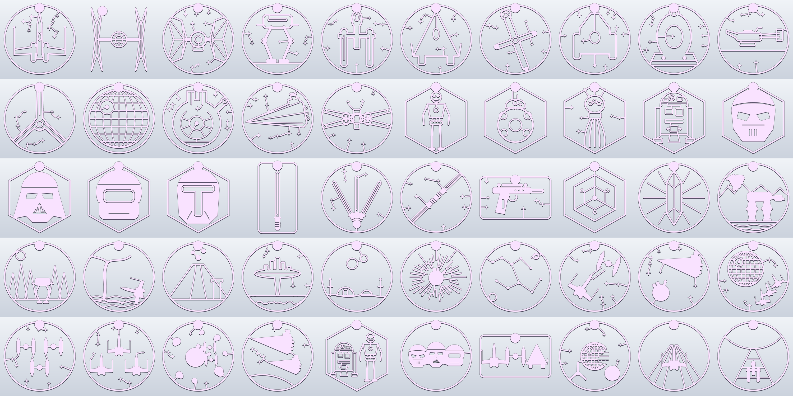

# Star Wars wall pack: 50 sturdy cutouts (fan art, personal use)

Each design is one piece, printed flat in one colour with no supports. This pack is built tougher than the earlier sets:

- **5 mm thick**, against 4 mm before.
- **Every line is widened by 0.8 mm**, so nothing is thinner than about 2.8 mm (7 or more extrusion widths at 0.4 mm). Bridges that join floating parts are 3.4 mm or wider.
- **Small ships inside scenes are filled silhouettes** rather than thin outlines.
- **The keyhole tab is larger (Ø26 mm)**, with a 1.6 mm slot, a 1.6 mm channel and a 1.8 mm solid cap. It takes a screw head up to 8.8 mm and a shank up to 4.4 mm. A pan-head screw left 4–5 mm proud of the wall holds it snugly.

Sizes are up to about 190 mm, which fits a 220 mm bed. Each one uses about 27 to 89 g of PLA. For the most stiffness, print with 3 to 4 walls; infill matters little at this thickness.

**Contents**
- **Ships:** X-wing (top and front), TIE interceptor, TIE advanced, AT-ST, Y-wing, A-wing, B-wing, snowspeeder, Firespray, speeder bike, Lambda shuttle, Death Star, Millennium Falcon, Star Destroyer.
- **Droids and helmets (hex frames):** protocol droid, BB unit, probe droid, astromech, stormtrooper, Vader, rebel pilot, Mandalorian.
- **Weapons and artefacts:** lightsaber, saber trio, saberstaff, blaster, holocron, kyber crystal.
- **Worlds:** Hoth battle, Endor forest, Dagobah, Mustafar, Cloud City, Tatooine homestead, hyperspace jump, star map.
- **Battles and groups:** dogfight, Falcon escape, Death Star attack, TIE squadron, X-wing squadron, asteroid chase, destroyer fleet, droid duo, helmet trio, starfighter row, Endor moon rising, hyperspace X-wing, Y-wing bombing run.

Each design has an `.stl`, an editable `.solidcraft` file and a `.png` render.
Star Wars and its designs belong to Lucasfilm. These are fan art: keep them for personal use and don't sell prints.

Rebuild with `python tools/wall_art/starwars_pack.py out/ [design ...]`. The strength settings are at the top of that file.
