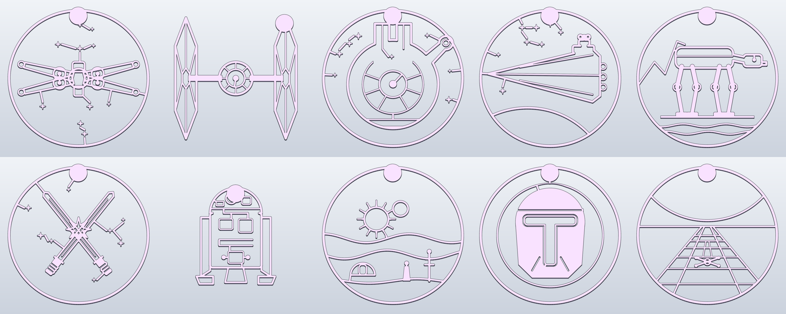

# Star Wars wall cutouts (fan art, personal use)

There are 10 line-art cutouts: x-wing, tie-fighter, millennium-falcon, star-destroyer, at-at, lightsaber-duel, astromech,
twin-suns, t-visor-helmet and trench-run.

They're built the same way as [`../wall-art-cutouts`](../wall-art-cutouts/README.md):
- each is one 4 mm piece with no backing plate;
- they print in one colour with no supports;
- a round tab at the top has a keyhole hanger on the back.

Sizes go up to 188 × 190 mm. Each one uses about 17 to 54 g of PLA.

These are fan art. Star Wars and its designs belong to Lucasfilm, so don't sell these prints.

Rebuild with `python tools/wall_art/starwars.py out/ [design ...]`.
