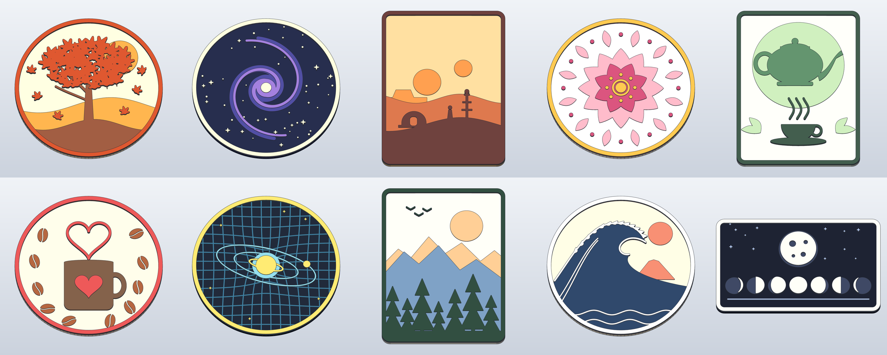

# Wall art: 10 layered vector-style plaques



Flat "vector art" scenes printed as relief: a 4.5 mm back plate plus three 1.2 mm levels, 8.1 mm total.
Each level is one colour, so a single-nozzle printer gets a 4-colour picture from three filament swaps.
Generated by [`tools/wall_art/wall_art.py`](../../tools/wall_art/wall_art.py) and built with SolidCraft.

| Scene | Size (mm) | Base · L1 · L2 · L3 |
|---|---|---|
| `autumn`: maple tree, falling leaves, sun over hills | Ø180 | cream · gold · brown · rust |
| `galaxy`: two-armed spiral galaxy and stars | Ø180 | navy · indigo · violet · starlight |
| `twin-suns`: desert sunset under two suns, domed hut, vaporator | 150 × 200 | sand · orange · terracotta · dark brown |
| `floral`: layered lotus mandala | Ø180 | ivory · pink · rose · gold |
| `tea`: teapot, steaming cup, tea leaves | 150 × 200 | mint · sage · green · dark green |
| `coffee-love`: mug with heart, heart-shaped steam, beans | Ø180 | latte · sienna · coffee · red |
| `spacetime`: ringed planet warping a spacetime grid, orbits | Ø180 | deep blue · teal · aqua · yellow |
| `wilderness`: mountains, pine forest, birds | 150 × 200 | ivory · peach · blue · pine green |
| `great-wave`: curling wave, sun and mountain | Ø180 | parchment · coral · navy · white |
| `lunar-phases`: full moon over the seven phases | 200 × 120 | night · slate · blue · moon white |

Exact hex colours are in the 3MF files and in `SCENES` in the generator.

## Files per scene

- `NAME.stl`: one watertight solid, ready to slice.
- `NAME.3mf`: the base and each level as separate coloured parts, for multi-colour printers (AMS/MMU).
- `NAME.solidcraft`: the editable SolidCraft design. Open it in SolidCraft to tweak it or export STEP.
- `NAME.png`: the render.

## Printing

- Print face up, flat on the bed. There are no overhangs, so you don't need supports.
- 0.2 mm layers, 0.4 mm nozzle. The smallest detail is about 0.9 mm wide.
- **Single nozzle:** insert colour changes (pauses) at **4.5 mm, 5.7 mm and 6.9 mm**. Start with the base colour.
- **Multi-colour:** load the 3MF and give each of the four parts its own filament.
- They fit a 220 mm bed. The plaques are 150 to 200 mm across, so the 180 mm Mini beds are too small for the larger ones.
- A solid print weighs about 160 to 240 g. With 2 to 3 walls and 15 % infill it comes to roughly a third of that.

## Hanging

A keyhole slot is cut into the back near the top. The nail or screw head goes into the round hole and slides up into the channel.
It takes a head up to 9 mm wide and a shank up to 4.5 mm.

## Regenerating

```sh
pip install shapely numpy scipy trimesh manifold3d   # plus solidcraft-cli on PATH
python tools/wall_art/wall_art.py out/            # all scenes
python tools/wall_art/wall_art.py out/ galaxy tea  # some scenes
```

Each scene is a short function of 2D shapes: circles, Béziers, strokes, leaves and stars.
To change a scene or add one, edit its function and add it to `SCENES`.
